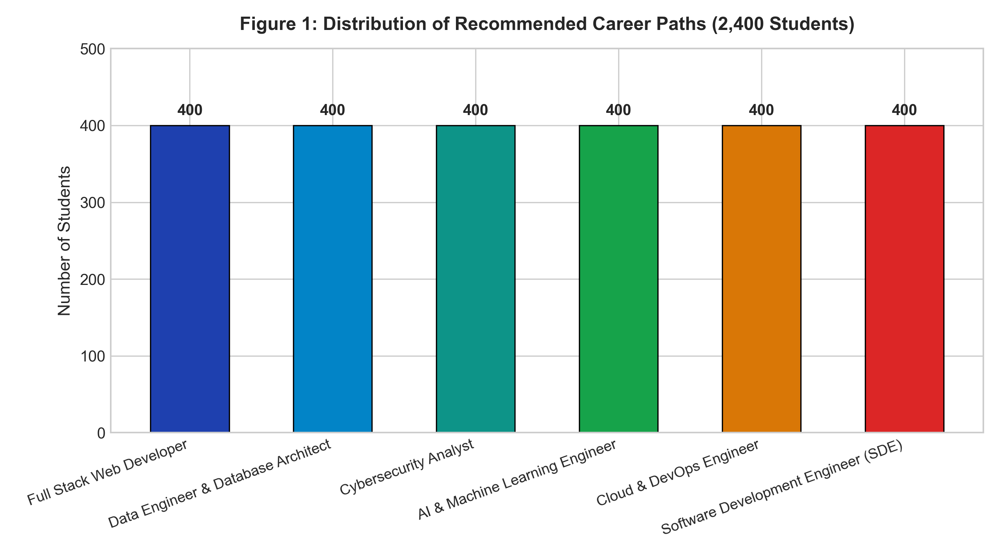
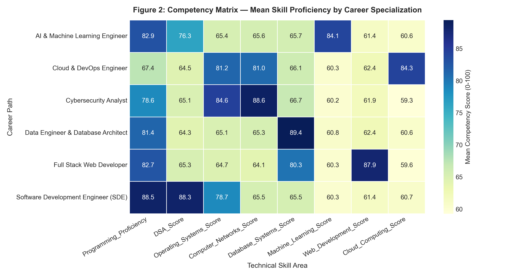
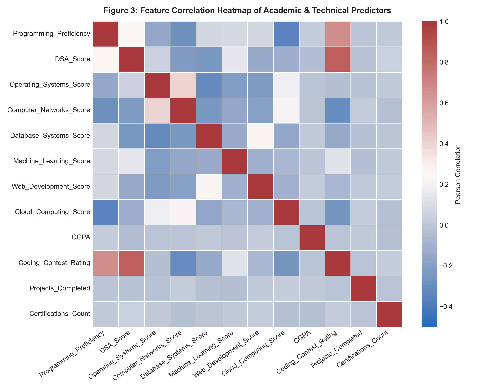
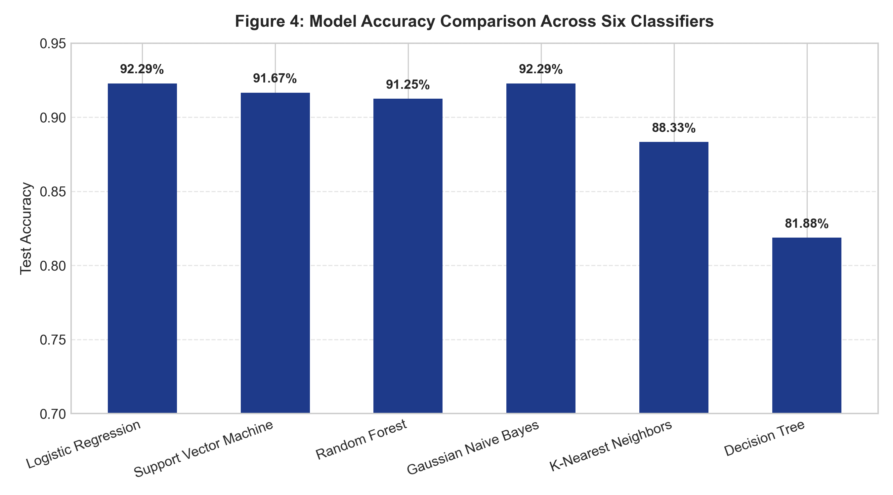
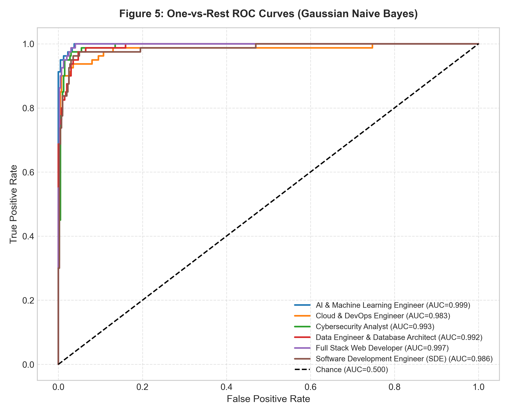
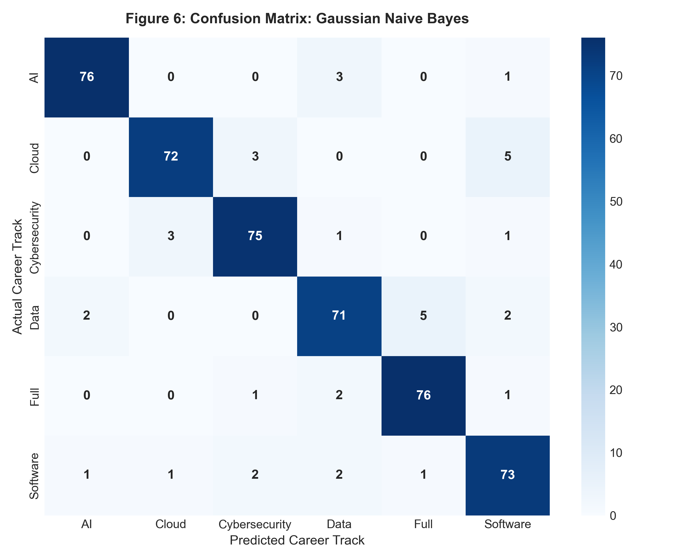
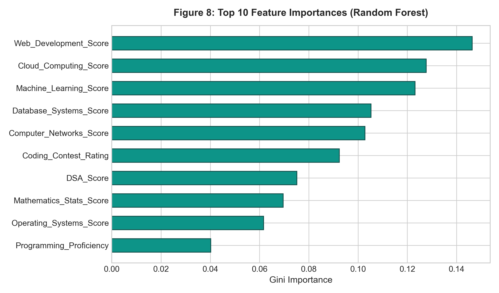
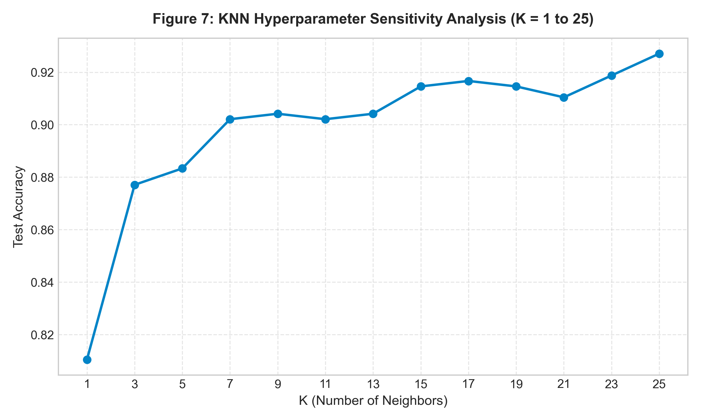
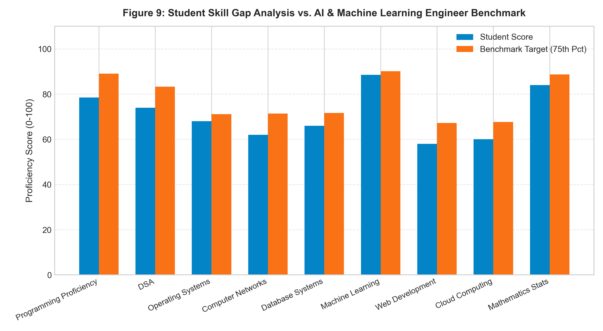

# AI-Based Student Skill Gap Analysis and Career Recommendation System
### An End-to-End Supervised Multi-Class Machine Learning & Skill Gap Benchmarking Framework

[](https://www.python.org/)
[](https://scikit-learn.org/)
[]()
[](LICENSE)

---

## 🏛️ Academic Information

- **Institution:** MNR University — School of Engineering, Technology & Artificial Intelligence
- **Department:** Department of Computer Science & Engineering (Artificial Intelligence & Machine Learning)
- **Course Name:** Machine Learning (Course Code: `25CSM201`)
- **Year & Semester:** 2nd Year, 1st Semester (2-1)
- **Academic Year:** 2026–2027
- **Lab Practical:** Experiment 30 — End-to-End Machine Learning Solution using a Real-World Dataset
- **Project Guide & Head of Department:** **Dr. Praveen M**

### 👤 Student Details

| Attribute | Details |
|:---|:---|
| **Student Name** | **K. Tanmaisri , Uzma begum , swetha** |
| **University Roll Number** | **`25RBAIM0049`,`25RBAIM0019`,`25RBAIM0050`** |
| **Branch / Degree** | **B.Tech (Hons.) Computer Science & Engineering (AI & ML)** |
| **Year / Semester** | **2nd Year, 1st Semester (2-1)** |
| **Academic Institution** | **MNR University, Telangana, India** |
| **Faculty Guide & HOD** | **Dr. Praveen M** |

---

## 📌 Project Overview & Problem Description

Engineering and technology students frequently face uncertainty regarding whether their present competencies match rapidly evolving industrial job expectations. Students often recognize their areas of interest but struggle to determine:
1. **Which technical competencies are currently deficient or missing.**
2. **Which specific skills should be prioritized for improvement first.**
3. **Which industrial career paths best align with their overall profile.**

### The Machine Learning Solution
This project develops an **AI-Based Student Skill Gap Analysis and Career Recommendation System** that analyzes a student's technical proficiencies, academic achievements, competitive coding metrics, and practical project experiences to:
- **Predict and recommend optimal career specialization tracks** across six key technology domains using supervised machine learning.
- **Compute quantitative, granular Skill Gap Indices (SGI)** against 75th-percentile industry benchmark standards.
- **Formulate personalized, prioritized curriculum and certification roadmaps** to bridge identified skill deficiencies before campus placement drives.

---

## 📊 Dataset Description & Career Tracks

- **Dataset File:** [`student_skills_career_dataset.csv`](./student_skills_career_dataset.csv)
- **Total Student Records:** **2,400 students**
- **Input Features:** **16 predictive variables** (academic, practical, competitive coding, and soft skills)
- **Target Variable:** `Recommended_Career` (6 Balanced Career Specializations, 400 students each)
- **Missing / Null Values:** **0** (100% complete and verified)

### Six Technology Career Specialization Tracks:
1. **AI & Machine Learning Engineer:** Advanced Machine Learning, Discrete Math & Statistics, Python, DSA.
2. **Software Development Engineer (SDE):** Data Structures & Algorithms, Competitive Programming, OS.
3. **Cybersecurity Analyst:** Computer Networks, Operating Systems, Cryptography, Security Auditing.
4. **Cloud & DevOps Engineer:** Cloud Architecture, Containerization (Docker/Kubernetes), Networking, OS.
5. **Data Engineer & Database Architect:** Database Management Systems (SQL/NoSQL), Big Data, Python.
6. **Full Stack Web Developer:** Frontend/Backend Web Development, REST APIs, UI/UX, Database Integration.

### Input Feature Summary:
| Domain | Features |
|:---|:---|
| **Academic Fundamentals** | `CGPA`, `Operating_Systems_Score`, `DSA_Score`, `Programming_Proficiency`, `Computer_Networks_Score`, `Database_Systems_Score`, `Machine_Learning_Score`, `Web_Development_Score`, `Cloud_Computing_Score`, `Mathematics_Stats_Score` |
| **Practical & Competitive Profile** | `Coding_Contest_Rating` (LeetCode/CodeChef scale), `Hackathons_Count`, `Projects_Completed`, `Certifications_Count`, `Internship_Months` |
| **Soft Skills** | `Soft_Skills_Rating` (Scale: 1.0 – 10.0) |

---

## 🧮 Mathematical Formulation & Skill Gap Logic

### 1. Skill Gap Index (SGI) Formula
Let $S = (s_1, s_2, \dots, s_d)$ denote the student's evaluated skill vector, and let $R = (r_1, r_2, \dots, r_d)$ represent the benchmark competency vector required for a target career role (established from top-quartile performers).

The skill gap for competency $i$ is calculated as:
$$\text{Gap}(i) = \max(0, R_i - S_i)$$
- If $S_i \ge R_i \implies \text{Gap}(i) = 0$ *(Identified Strength / Requirement Satisfied)*
- If $S_i < R_i \implies \text{Gap}(i) > 0$ *(Quantified Deficiency / Priority Learning Area)*

### 2. Weighted Role Alignment Match Score
$$\text{Match Score} = 100 \times \frac{\sum_{i=1}^{d} w_i \times \min(S_i, R_i)}{\sum_{i=1}^{d} w_i \times R_i}$$
where $w_i$ represents the importance weight assigned to competency $i$ for that specific career role.

---

## 🤖 Machine Learning Algorithms Benchmarked

Six supervised classification algorithms were trained, benchmarked, and cross-validated on identical 80:20 stratified partitions:

1. **Logistic Regression (Multinomial with L2 Regularization):**
   $$\mathcal{P}(y = k \mid \mathbf{x}) = \frac{e^{\mathbf{w}_k^T \mathbf{x} + b_k}}{\sum_{j=1}^{K} e^{\mathbf{w}_j^T \mathbf{x} + b_j}}$$
2. **Support Vector Machine (SVM with RBF Kernel):**
   $$K(\mathbf{x}, \mathbf{x}') = \exp(-\gamma \|\mathbf{x} - \mathbf{x}'\|^2)$$
3. **Random Forest Classifier (Ensemble Bagging of 100 Trees):**
   $$y_{\text{pred}} = \text{mode}\Big(T_1(\mathbf{x}), T_2(\mathbf{x}), \dots, T_{100}(\mathbf{x})\Big)$$
4. **Gaussian Naive Bayes (Probabilistic Classifier):**
   $$\mathcal{P}(x_i \mid y) = \frac{1}{\sqrt{2\pi\sigma^2}} \exp\left(-\frac{(x_i - \mu)^2}{2\sigma^2}\right)$$
5. **K-Nearest Neighbors (KNN with Standardized Euclidean Distance):**
   $$d(\mathbf{x}, \mathbf{x}') = \sqrt{\sum_{i=1}^{d} (x_i - x_i')^2}$$
6. **Decision Tree Classifier (Gini Impurity Splitting):**
   $$\text{Gini}(p) = 1 - \sum_{i=1}^{K} p_i^2$$

### 🛡️ Data Leakage Prevention Architecture
Feature scaling via `StandardScaler` is strictly embedded within Scikit-learn **`Pipeline`** architectures, ensuring scaling parameters are fitted exclusively on training folds.

---

## ⚙️ Installation and Execution Guide

### Prerequisites
- Python 3.9+ or Anaconda environment.
- Git installed.

### Step 1: Clone the Repository
```bash
git clone https://github.com/your-username/AI-Based-Student-Skill-Gap-Analysis-and-Career-Recommendation-System.git
cd AI-Based-Student-Skill-Gap-Analysis-and-Career-Recommendation-System
```

### Step 2: Install Python Dependencies
```bash
pip install -r requirements.txt
```

### Step 3: Run the Complete Machine Learning Pipeline
```bash
python student_skill_gap_career_recommendation.py
```

### Step 4: Run the Interactive Jupyter Notebook
```bash
jupyter notebook Student_Skill_Gap_Career_Recommendation.ipynb
```

---

## 📈 Experimental Results & Performance Benchmarks

### Multi-Model Benchmark Comparison Table (Held-Out 20% Test Set, 480 Samples)

| Classifier Algorithm | 5-Fold CV Acc | Test Accuracy | Precision (W) | Recall (W) | F1-Score (W) | ROC-AUC (OvR) |
|:---|:---:|:---:|:---:|:---:|:---:|:---:|
| 🏆 **Logistic Regression** | **92.14%** | **92.29%** | **0.9234** | **0.9229** | **0.9229** | **0.9931** |
| 🥈 **Gaussian Naive Bayes** | 91.25% | **92.29%** | **0.9234** | **0.9229** | **0.9230** | 0.9915 |
| 🥉 **Support Vector Machine (RBF)** | 90.68% | 91.67% | 0.9173 | 0.9167 | 0.9163 | **0.9925** |
| **Random Forest (100 Trees)** | 90.42% | 91.25% | 0.9131 | 0.9125 | 0.9121 | 0.9880 |
| **K-Nearest Neighbors (K=5)** | 88.91% | 88.33% | 0.8832 | 0.8833 | 0.8826 | 0.9771 |
| **Decision Tree (Unconstrained)** | 80.99% | 81.88% | 0.8183 | 0.8188 | 0.8181 | 0.8912 |

> **Champion Model Selected:** **Logistic Regression** achieved the highest test accuracy (**92.29%**), cross-validation accuracy (**92.14%**), and multi-class ROC-AUC (**0.9931**).

---

## 📊 Publication-Quality Diagnostic Visualizations

### 1. Career Distribution & Competency Matrix
| Figure 1: Class Distribution (2,400 Students) | Figure 2: Competency Matrix Heatmap |
|:---:|:---:|
|  |  |

### 2. Feature Correlation Matrix Heatmap


### 3. Model Accuracy Comparison & Multi-Class ROC Curves
| Figure 4: Model Accuracy Comparison | Figure 5: Multi-Class ROC Curves (OvR) |
|:---:|:---:|
|  |  |

### 4. Confusion Matrix & Random Forest Feature Importances
| Figure 6: Confusion Matrix (Champion Model) | Figure 8: Top 10 Feature Importances |
|:---:|:---:|
|  |  |

### 5. Hyperparameter Sensitivity (KNN K = 1 to 25)


### 6. AI-Based Skill Gap Analysis vs. Role Benchmark


---

## 🔍 Demonstration: Single-Student Skill Gap Audit & Inference

### Input Profile:
- **CGPA:** 8.1 / 10.0 | **Coding Contest Rating:** 1620 | **Hackathons:** 3 | **Projects:** 4
- **Technical Scores:** ML: 88.5, Math/Stats: 84.0, Programming: 78.5, DSA: 74.0, Database: 66.0, Cloud: 60.0, Networks: 62.0, Web Dev: 58.0

### Inference Outcome:
- **Recommended Career Track:** **AI & Machine Learning Engineer** (Confidence: **99.99%**)

### Quantitative Skill Gap Matrix vs. 75th-Percentile Benchmark:
| Technical Competency | Student Score | Benchmark Target | Delta ($\Delta$) | Status | Actionable Remediation Guidance |
|:---|:---:|:---:|:---:|:---:|:---|
| **Machine Learning** | 88.5 | 90.1 | -1.6 pts | Core Strength | Undertake end-to-end LLM/Transformer project |
| **Mathematics & Stats** | 84.0 | 88.7 | -4.7 pts | Minor Gap | Review Bayesian optimization & Matrix Calculus |
| **Database Systems** | 66.0 | 71.7 | -5.7 pts | Actionable Gap | Practice SQL indexing & query optimization on LeetCode |
| **Cloud Computing** | 60.0 | 67.7 | -7.6 pts | Deficit | Complete AWS Cloud Practitioner & deploy Docker containers |
| **DSA & Algorithms** | 74.0 | 83.3 | -9.3 pts | Deficit | Solve 50 medium LeetCode DSA questions |
| **Computer Networks** | 62.0 | 71.4 | -9.4 pts | Deficit | Practice socket programming & Wireshark packet audits |
| **Programming (Python)** | 78.5 | 89.1 | -10.5 pts | Deficit | Build a production-grade asynchronous backend API |

---


## ⚖️ Ethical Governance & Academic Declaration

1. **Advisory Decision Support:** System recommendations are intended purely as informative guidance to empower students and mentors, **never** as automated admissions or placement gatekeeping instruments.
2. **Privacy Protection:** Profiling relies on anonymized, consensual academic metrics without tracking private personal communications.
3. **Academic Integrity:** This mini-project entitled **"AI-Based Student Skill Gap Analysis and Career Recommendation System"** represents original work submitted for the Machine Learning Laboratory (Course Code: `25CSM201`) at MNR University.

